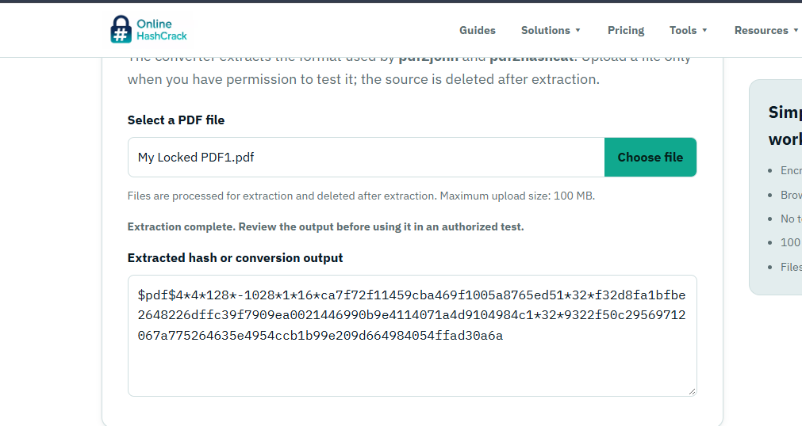
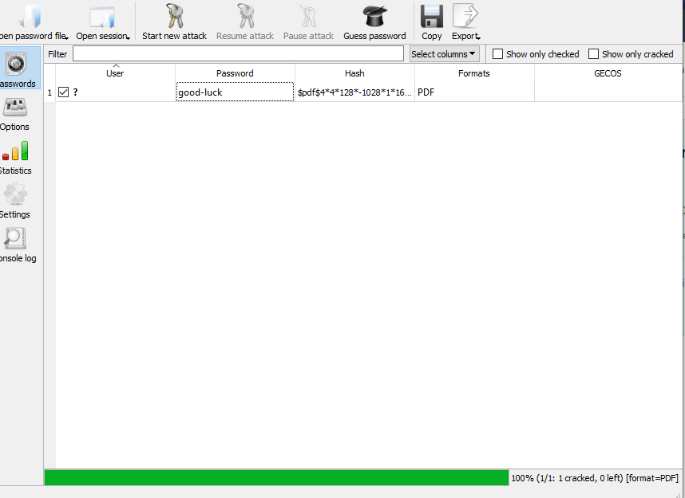

# W3: Password Cracking with JTR and Networkwalks Tools

**Programme:** Networkwalks Cybersecurity Internship | **Week 3**
**Target files:** `My Locked PDF1.pdf`, `My Locked PDF2.pdf`, `My Locked PDF3.pdf` (password-protected PDFs supplied for this exercise)
**Scope:** Password recovery on files provided for this lab. No other systems were touched. For educational use.

---

## W3-PM1: Password Cracking with John the Ripper (JTR) and Johnny

The same three-step process was repeated for each of the three locked PDFs: extract the hash, load it into Johnny, run the attack, then open the PDF with the recovered password to confirm the flag.

### File 1: My Locked PDF1.pdf

**Step 1 — Extract the hash** with the Online HashCrack PDF Hash Extractor (`onlinehashcrack.com/tools-pdf-hash-extractor.php`), which runs `pdf2john` and returns a crackable hash. The tool states uploaded files are deleted after extraction.

```
$pdf$4*4*128*-1028*1*16*ca7f72f11459cba469f1005a8765ed51*32*f32d8fa1bfbe2648226dffc39f7909ea0021446990b9e4114071a4d9104984c1*32*9322f50c29569712067a775264635e4954ccb1b99e209d664984054ffad30a6a
```


**Step 2 — Load into Johnny and attack.** Password cracked: **`good-luck`**.


**Step 3 — Open the PDF** with `good-luck`. Flag captured:
```
nw{cybersecurity_flag_captured_2608}
```


### File 2: My Locked PDF2.pdf

**Step 1 — Extract the hash:**
```
$pdf$4*4*128*-1028*1*16*0853f2cde0ef15b1c0f93ed229d3b1ad*32*8f13ce5aa39ad974364d36a057da76790021446990b9e4114071a4d9104984c1*32*ceecdac74b19b5a62688d3b3524e1374c955cbb9cc3c45316494d9446ef81af1
```


**Step 2 — Load into Johnny and attack.** Password cracked: **`password1`**.


**Step 3 — Open the PDF** with `password1`. Flag captured:
```
nw{networkwalks_persistence_jtr_270521}
```


### File 3: My Locked PDF3.pdf

**Step 1 — Extract the hash:**
```
$pdf$4*4*128*-1028*1*16*34eb542eff4e1b0b32d25ce15a9a7281*32*b77872bfc9a24fb2f845066283a8fc1b0021446990b9e4114071a4d9104984c1*32*e7572256e4b552cd57988f5134214b91920d94d7a6bf550ea94a2995c7f2ab02
```


**Step 2 — Load into Johnny and attack.** Password cracked: **`1qaz2wsx`**.


**Step 3 — Open the PDF** with `1qaz2wsx`. Flag captured:
```
nw{networkwalks_flag_260821_1}
```


### Attacker's view

All three files fell to the same dictionary-style attack, even though the passwords looked different at a glance. `good-luck` and `password1` are common phrases that appear in most password wordlists. `1qaz2wsx` looks more complex, but it is a well-known **keyboard-walk pattern** (adjacent keys typed in sequence), and keyboard-walk lists are a standard part of any serious wordlist. None of the three required brute-force guessing character by character; all were found by pattern or dictionary matching.

### Defender's view

A password that "looks" strong to the eye, like `1qaz2wsx`, can still be weak if it follows a recognisable keyboard pattern. Strength should be judged by unpredictability, not just length or character variety. Long, unrelated passphrases resist both dictionary and pattern-based attacks far better.

---

## W3-PM2: Password Cracking with Networkwalks' own tools

To cross-validate the JTR results, the same hash extraction and cracking process was repeated using Networkwalks' own browser-based tools.

### Step 1: Extract the hash with the Networkwalks Hash Calculator

Uploaded `My Locked PDF1.pdf` to `networkwalks.com/hash-calculator/` (PDF tab). The tool parses the file locally in the browser and returned the **same hash** as the Online HashCrack extraction above, confirming both extraction methods agree:

```
$pdf$4*4*128*-1028*1*16*ca7f72f11459cba469f1005a8765ed51*32*f32d8fa1bfbe2648226dffc39f7909ea0021446990b9e4114071a4d9104984c1*32*9322f50c29569712067a775264635e4954ccb1b99e209d664984054ffad30a6a
```


### Step 2: Crack a hash with the Networkwalks Password Cracker

To cross-check the method against a second file, PDF2's hash (already extracted above) was pasted into `networkwalks.com/password-cracker/` and run against the tool's built-in 100-word list.

```
$pdf$4*4*128*-1028*1*16*0853f2cde0ef15b1c0f93ed229d3b1ad*32*8f13ce5aa39ad974364d36a057da76790021446990b9e4114071a4d9104984c1*32*ceecdac74b19b5a62688d3b3524e1374c955cbb9cc3c45316494d9446ef81af1
```

**Result:** password cracked as **`password1`**, matching the Johnny/JTR result for PDF2 in PM1.


### Why two tools, one answer

Both John the Ripper and the Networkwalks Password Cracker run the same kind of attack: a dictionary attack, checking words from a list against the hash. Getting the same password (`password1` for PDF2) from two independent tools confirms the result and shows how effective dictionary attacks are against passwords built from real words or common patterns.

---

## Combined findings

| File | Hash (pdf2john/hashcat format) | Cracked password | Flag |
|---|---|---|---|
| My Locked PDF1.pdf | `$pdf$4*4*128*-1028*1*16*ca7f72f11459...9322f50c...ffad30a6a` | `good-luck` | `nw{cybersecurity_flag_captured_2608}` |
| My Locked PDF2.pdf | `$pdf$4*4*128*-1028*1*16*0853f2cde0ef...ceecdac7...d9446ef81af1` | `password1` | `nw{networkwalks_persistence_jtr_270521}` |
| My Locked PDF3.pdf | `$pdf$4*4*128*-1028*1*16*34eb542eff4e...e7572256...94a2995c7f2ab02` | `1qaz2wsx` | `nw{networkwalks_flag_260821_1}` |

All three files share the same encryption settings (Revision 4, 128-bit key), but each has an independent password and hash.

## Key takeaways

1. A password-protected file's strength depends entirely on the password itself, not the file format or encryption algorithm.
2. Dictionary and pattern-based attacks are fast against real words, common phrases and keyboard-walk patterns; they are far slower against long, random passphrases.
3. Extracting a hash is non-destructive and doesn't require touching the original service that generated the file, which is why password hash cracking is usually done offline.
4. Running the same attack with two different tools (JTR/Johnny and Networkwalks' own tools) cross-validates the finding.
5. Across three files, every password fell to a basic 100-word built-in list, which shows how much risk predictable passwords carry even when they look different from each other.

## Ethics & scope

This exercise was performed only on files supplied for the Networkwalks lab. Password cracking tools should only be used on files and accounts you own or have explicit, written permission to test.

---
*Author: Chinedu Okoli | 
